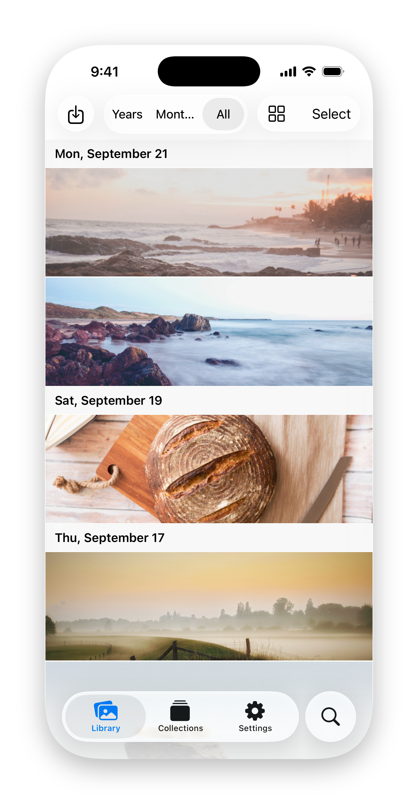

<!-- GENERATED by `cargo run -p xtask -- translate-readme` from README.md. Do not edit by hand. -->
<!-- translate-readme: locale=de source-fingerprint=2ae647b36cb0f7e9. Regenerate with `mise run translate-readme`. -->

# Capsule

  <picture>
    <source media="(prefers-color-scheme: dark)" srcset="images/readme-hero-dark.png">
    
  </picture>

Open-Source-Fotobibliothek für Fotografen und Prosumer: föderiert und Ende-zu-Ende-verschlüsselt.

## Ziele

- **Ihre Bibliothek überdauert jeden Dienst.** Originale werden dauerhaft, in voller Qualität und mit ihren Metadaten gespeichert und lassen sich jederzeit Byte für Byte wiederherstellen.
- **Ende-zu-Ende-Kryptografie.** Der Server speichert nur Chiffretext. Jedes Asset trägt eine signierte Herkunftskette, sodass sich überprüfen lässt, wer es aufgenommen, importiert und bearbeitet hat, statt es nur zu glauben.
- **Föderiertes Teilen.** Da das Vertrauen in der Kryptografie und nicht in einem Server liegt, können Menschen auf unterschiedlichen Servern Alben miteinander teilen: Stellen Sie sich [Matrix](https://en.wikipedia.org/wiki/Matrix_(protocol)) vor, nur für Bilder.
- **Open Source für den Netzwerkeffekt.** Ein offenes Protokoll und ein selbst hostbarer Server lassen jeden dem Netzwerk beitreten; das Ziel ist der erste offene, föderierte Standard für persönliche Fotobibliotheken.
- **Überall nativ.** Jede Plattform erhält einen echten nativen Client; die CLI/TUI ist der Referenzclient und bleibt der robusteste.

## Status

Alpha, noch nicht geeignet für Daten, die Sie nicht verlieren dürfen. Der aktuelle Fokus liegt auf dem ersten Dogfooding-fähigen Release: Die Rust-CLI/TUI importiert, der Server speichert dauerhaft, und jeder Schritt dieses Pfades ist durch automatisierte Tests abgedeckt. Native Apps folgen, sobald dieser Pfad stabil ist. Die [Roadmap](ROADMAP.md) beschreibt den geplanten Weg.

## Erste Schritte

- [Erste Schritte](https://capsule.justinchung.net/guides/getting-started/) und das [Benutzerhandbuch](https://capsule.justinchung.net/guides/user-guide/).
- [Self-Hosting](https://capsule.justinchung.net/guides/self-hosting/) eines Servers.
- [Design-Dokumente](https://capsule.justinchung.net/design/) dazu, wie es funktioniert.

## Repository

| Pfad | Was es ist |
| --- | --- |
| `capsule-core` | Rust-Kern: Kryptografie, Medien, Metadaten, lokale Bibliothek |
| `capsule-sdk` | Rust-Client-SDK über dem generierten API-Client |
| `capsule-cli` | Die `capsule`-CLI und -TUI |
| `capsule-server` | Der Server (Kynos REST/OpenAPI) |
| `capsule-e2e` | End-to-End-Tests über die echten Binärdateien |
| `capsule-swift`, `capsule-android` | Native Apple- und Android-Clients |
| `capsule-web` | Schreibgeschützter Web-Client |
| `capsule-docs` | Dokumentationswebsite |

Installieren Sie [mise](https://mise.jdx.dev), führen Sie `mise install` und `mise run hooks-install` aus und lesen Sie dann [CONTRIBUTING.md](CONTRIBUTING.md). Melden Sie Fehler in GitHub Issues; stellen Sie Fragen zur Einrichtung in GitHub Discussions.

## Mitwirken und Lizenz

Beiträge erfordern ein unterzeichnetes [CLA](CLA.md): Ein einziger Inhaber der Urheberrechte macht die Verbreitung in App Stores erst möglich, und jede öffentliche Veröffentlichung bleibt unter einer OSI-anerkannten Lizenz.

Capsule wird unter [AGPL-3.0-only](LICENSE) veröffentlicht; Hinweise zu Drittanbietern stehen in [NOTICE](NOTICE). Der Inhaber der Urheberrechte, Justin Chung, kann es auch unter gesonderten Bedingungen anbieten, etwa wie App Stores sie verlangen; jede Version, die Sie unter der AGPL erhalten, bleibt Ihnen unter der AGPL erhalten. Siehe das [Lizenz-Design-Dokument](https://capsule.justinchung.net/design/licensing/).
