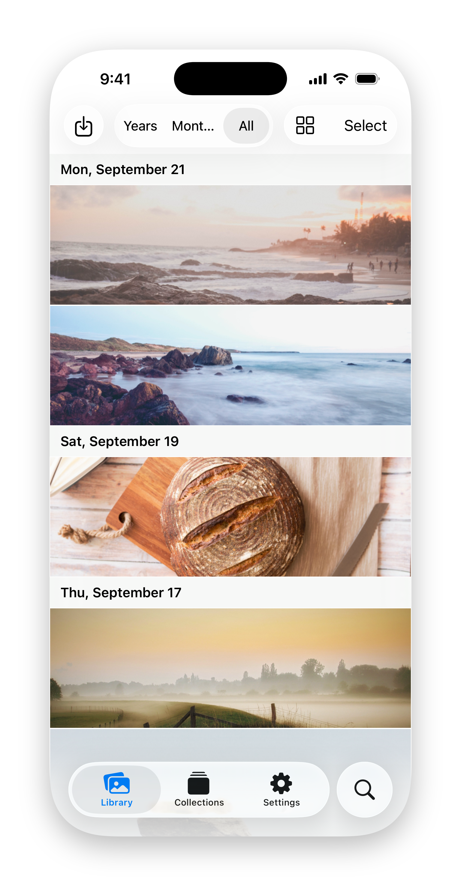

<!-- GENERATED by `cargo run -p xtask -- translate-readme` from README.md. Do not edit by hand. -->
<!-- translate-readme: locale=ru source-fingerprint=be3490a753a89c6c. Regenerate with `mise run translate-readme`. -->

  <picture>
    <source media="(prefers-color-scheme: dark)" srcset="images/logo-dark.svg">
    
  </picture>

<!-- languages:begin -->

<a href="README.md">English</a> · <a href="README.zh-Hans.md">简体中文</a> · <a href="README.zh-Hant.md">繁體中文</a> · <a href="README.ja.md">日本語</a> · <a href="README.ko.md">한국어</a> · <a href="README.fr.md">Français</a> · <a href="README.de.md">Deutsch</a> · <a href="README.es.md">Español</a> · <a href="README.pt-BR.md">Português (Brasil)</a> · <a href="README.it.md">Italiano</a> · <a href="README.ru.md">Русский</a> · <a href="README.hi.md">हिन्दी</a> · <a href="README.ar.md">العربية</a>

<!-- languages:end -->

  
  
  

  <picture>
    <source media="(prefers-color-scheme: dark)" srcset="images/readme-hero-dark.png">
    
  </picture>

**Фотобиблиотека, которая сама упорядочивает миллионы фотографий, в которую не может заглянуть ни один сервер и которая позволяет делиться между серверами так же, как электронная почта.** Capsule — проект с открытым исходным кодом и сквозным шифрованием, созданный для тех, кто делает тысячи снимков в год, для фотографов, чьи RAW-файлы — их заработок, для путешественников, привозящих мир домой на карте памяти, и для семей, хранящих воспоминания десятилетий. Запустите его на своём сервере или на сервере друга и делитесь с кем угодно, на любом сервере.

> [!NOTE]
> **Альфа-версия.** Мобильные клиенты стабилизируются и дорабатываются перед передачей бета-тестерам. Следите за ходом работы по [дорожной карте](ROADMAP.md).

## Почему Capsule

- **Миллионы фотографий, упорядоченные систематически и автоматически.** Каждый импорт попадает на единую ленту, пары RAW+JPEG и серии снимков\* собираются в стопки, дубликаты распознаются по содержимому, а смарт-альбомы обновляются сами. В библиотеке из миллионов снимков ориентироваться так же легко, как в библиотеке из сотен.
- **Приватность заложена в устройство системы, а не в обещания.** Фотографии шифруются на ваших устройствах ещё до того, как их покинуть. Сервер хранит только шифротекст и никогда не получает ключей, поэтому их не может увидеть даже тот, кто этим сервером управляет.
- **Доказательство происхождения каждой фотографии.** Каждая фотография несёт подписанную историю того, кто её снял, импортировал и отредактировал, поэтому её происхождение можно проверить, а не принимать на веру.
- **Обмен между серверами.** Люди на разных серверах делятся альбомами друг с другом — так же, как электронная почта работает между разными провайдерами. Никому не нужно регистрироваться на вашем сервере, и никакая компания не стоит посередине.
- **Вся ваша библиотека, даже офлайн.** Каждое приложение хранит индекс всего, что вы когда-либо сохраняли, поэтому вы можете просматривать, искать и упорядочивать всю библиотеку в самолёте, на границе или вдали от любой связи.
- **Прямо с камеры.** Переносите фотографии с камеры напрямую по Wi-Fi или кабелю, а контрольная сумма каждого файла проверяется при получении.
- **Библиотека, которая переживёт Capsule.** Рядом с каждой фотографией хранится подписанный файл-спутник в открытом формате, поэтому ваша библиотека остаётся читаемой без приложения, без базы данных и без нас.
- **Нативно на любом устройстве\*.** Настоящие нативные приложения, следующие дизайну своей платформы, веб-просмотрщик для всех, с кем вы делитесь, а также скриптуемые командная строка и терминальный интерфейс.

\* Появится позже, в порядке востребованности.

## Всё, чего вы ожидаете

- Альбомы, а также ваши оригиналы, сохранённые байт в байт вместе с метаданными и восстанавливаемые в точности такими, какими были загружены
- Поиск по дате, месту, камере, объективу, рейтингу и метке, выполняемый на вашем устройстве
- Рейтинги и отметки «выбрано» и «отклонено» для отбора снимков со съёмки; метки и подписи
- Карта мест, где была сделана каждая фотография, с исправлением геопозиции, сохраняющим оригинал
- Публичные ссылки, которые любой может открыть в браузере, и ссылки для загрузки, через которые гости добавляют свои фотографии к вашим
- Резервное копирование, которое продолжается с места остановки, и синхронизация между устройствами по локальной сети
- Корзина с периодом восстановления, скрытые фотографии и восстановление аккаунта при потере устройства
- Приложения на 13 языках

## В планах

- **ИИ на устройстве.** Ищите простыми словами («закат над гаванью»), находите людей, питомцев и места, выделяйте лучшие снимки — всё вычисляется на ваших устройствах. Подсказки ИИ хранятся отдельно от ваших собственных меток и никогда их не перезаписывают.
- **Встроенное сжатие изображений с учётом формата.** Выбирайте сжатие без потерь или с потерями для каждого формата, чтобы библиотека занимала меньше места — строго на ваших условиях.
- **Больше импортёров.** Переезд в один шаг из Фото iCloud и Immich, наряду с Google Фото.
- **Приложения для Windows и Linux** — после приложений для телефона, планшета и Mac.

## Начало работы

- **Попробуйте.** [Руководство по началу работы](https://capsule.justinchung.net/guides/getting-started/) поможет настроить локальную библиотеку на вашем компьютере; сервер не нужен.
- **Перенесите свою библиотеку.** Импортируйте папки, диски и карты памяти, загружайте снимки с камеры или [переезжайте из Google Фото](https://capsule.justinchung.net/guides/google-photos-migration/).
- **Запустите сервер** для себя, семьи или друзей: [самостоятельный хостинг](https://capsule.justinchung.net/guides/self-hosting/).
- **Узнайте, как всё устроено**, из [проектных документов](https://capsule.justinchung.net/design/).

## Переводы

<!-- translations:begin -->

| Язык | README | Переведено строк приложения | Проверено носителем языка |
| --- | --- | --- | --- |
| 简体中文 | [README.zh-Hans.md](README.zh-Hans.md) |  |  |
| 繁體中文 | [README.zh-Hant.md](README.zh-Hant.md) |  |  |
| 日本語 | [README.ja.md](README.ja.md) |  |  |
| 한국어 | [README.ko.md](README.ko.md) |  |  |
| Français | [README.fr.md](README.fr.md) |  |  |
| Deutsch | [README.de.md](README.de.md) |  |  |
| Español | [README.es.md](README.es.md) |  |  |
| Português (Brasil) | [README.pt-BR.md](README.pt-BR.md) |  |  |
| Italiano | [README.it.md](README.it.md) |  |  |
| Русский | [README.ru.md](README.ru.md) |  |  |
| हिन्दी | [README.hi.md](README.hi.md) |  |  |
| العربية | [README.ar.md](README.ar.md) |  |  |

<!-- translations:end -->

Переводы начинаются как машинные черновики и помечаются как проверенные, когда их одобрит человек, свободно владеющий языком. Чтобы помочь, прочитайте [locales/README.md](locales/README.md), [запросите язык](https://github.com/Capsulsaurus/Capsule/issues/new?template=language-request.md) или [сообщите об ошибке перевода](https://github.com/Capsulsaurus/Capsule/issues/new?template=translation-error.md).

## Участие

Установите [mise](https://mise.jdx.dev), выполните `mise install` и `mise run hooks-install`, затем прочитайте [CONTRIBUTING.md](CONTRIBUTING.md). О багах сообщайте в GitHub Issues; вопросы по настройке задавайте в GitHub Discussions. Для вклада требуется подписанное [CLA](CLA.md): единственный правообладатель — это то, что делает возможным распространение через магазины приложений, а каждый публичный выпуск остаётся под лицензией, одобренной OSI.

| Путь | Что это |
| --- | --- |
| `capsule-core` | Ядро на Rust: криптография, медиа, метаданные, локальная библиотека |
| `capsule-sdk` | Клиентский SDK на Rust поверх сгенерированного API-клиента |
| `capsule-cli` | CLI и TUI `capsule` |
| `capsule-server` | Сервер (Kynos REST/OpenAPI) |
| `capsule-e2e` | Сквозные тесты на реальных бинарных файлах |
| `capsule-swift`, `capsule-android` | Нативные клиенты для Apple и Android |
| `capsule-web` | Веб-клиент только для чтения |
| `capsule-docs` | Сайт документации |

## Лицензия

Capsule распространяется по лицензии [AGPL-3.0-only](LICENSE); уведомления о сторонних компонентах находятся в [NOTICE](NOTICE). Правообладатель, Justin Chung, может также предлагать его на отдельных условиях, например таких, каких требуют магазины приложений; любая версия, полученная вами под AGPL, остаётся вашей под AGPL. См. [проектный документ о лицензировании](https://capsule.justinchung.net/design/licensing/).
