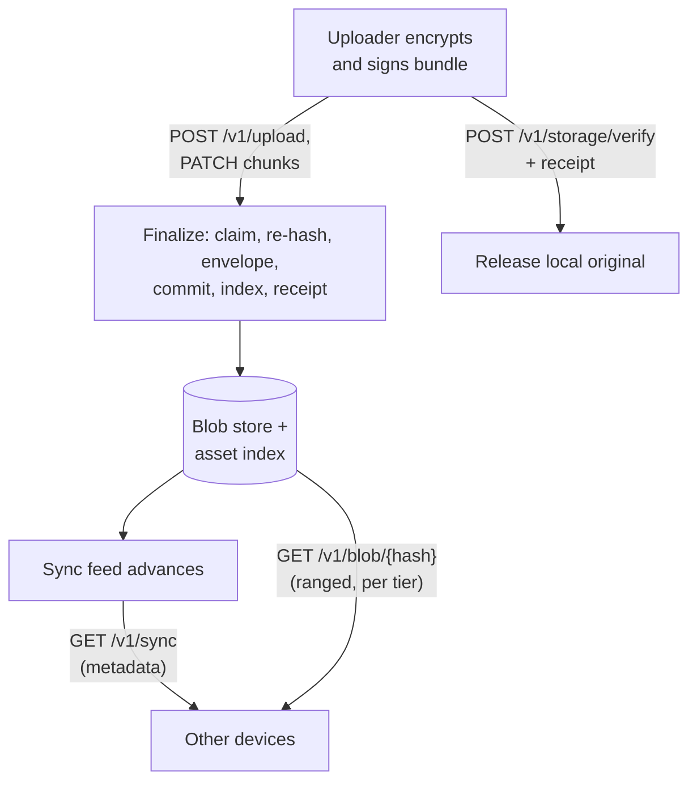

The **transfer protocol** moves blob bytes between a client and its home server in both directions. It is Capsule-owned: session state, encrypted-blob provenance, finalization and access are one end-to-end security contract, so it offers no generic transfer library or TUS compatibility. The server never holds a key. Every byte it moves is opaque ciphertext except the signed provenance manifest, which is server-visible by design.

| Page                             | Covers                                                                                    |
| -------------------------------- | ----------------------------------------------------------------------------------------- |
|      | Resumable upload sessions, chunk rules, finalization, staged tiers T0/T1/T2, error codes  |
|    | Tiered and ranged fetch, blob access scoping, the fallback ladder, the transfer scheduler |
|  | Storage verification, deep re-hash, custody receipts, releasing local originals           |

_What_ changed, the metadata feed a client reads before deciding what to fetch, is , not this protocol. Implementations: `capsule-server::upload`, `capsule-server::blob`, `capsule-server::verify`, `capsule-server::attestation`, `capsule-sdk::upload`, `capsule-sdk::fetch`, `capsule-sdk::verify`, `capsule-sdk::staged`. Wire shapes are the OpenAPI contract (); these pages fix the semantics the schema cannot express.

## Invariants

Every implementation, on either side, MUST uphold:

1. **Blobs are immutable and content-addressed.** A blob is named by the hash of its stored bytes, the ciphertext content hash (); bytes at an address never change. Identical bytes are one object.
2. **The wire is strict.** A request that violates the contract is rejected with a machine-readable `error.*` code, never silently corrected or partially honoured.
3. **A chunk is acknowledged only after it is durably committed.** The server fsyncs the staged range and records it in the committed set before answering `204`. An acknowledged byte is a byte on disk, and no write ever touches a committed byte.
4. **Finalize re-hashes before commit.** The server recomputes the content hash over the staged bytes and re-runs the envelope checks before the blob is committed to its address. A mismatch is corruption, never retried server-side.
5. **An index row never points at a missing blob.** The blob is committed (atomic rename plus directory fsync) before any index row references it. The failure direction is an unreferenced blob, which GC collects, never a dangling reference.
6. **Custody and receipt are one fact.** A receipt is written in the same transaction that indexes the committed blob; neither exists without the other.
7. **A client releases a local original only on server custody**: a `durable` storage verdict, a verified signed custody receipt whose server-recomputed hash matches the bytes the client sent (the read-back hash), and `verify_asset` acceptance (; ).
8. **Resume is driven by server truth, not client state.** The committed set comes from `HEAD`, in-flight sessions from `GET /v1/upload/sessions`, held tiers from the sync feed. Client-side queues are rebuildable caches.
9. **Every transfer step is idempotent.** Re-creating a session, re-sending a chunk, re-finalizing, re-fetching a range and re-verifying all converge on the same state.
10. **Every session terminates.** A session is driven to `Completed` or `FailedProcessing`, or discarded, and no staged file or reserved row outlives it.
11. **The server never produces manifest bytes.** Manifests travel as `provenance` blobs and are served verbatim.
12. **Semantics never depend on the transport.** Every operation means the same over HTTP/1.1, HTTP/2 and HTTP/3, and correctness survives the loss of any connection at any moment ().
13. **No request waits on unbounded server work.** A request answers with the state as it stands; finalization and other long work run detached and are observed through `HEAD`.

## Flow

## Failure Model

The invariants above hold only under stated assumptions about the hardware and filesystems underneath. This section states those assumptions, what each side does when one breaks, and how the break is found. The rule throughout is the system invariant: a fault may refuse a write or cost a re-transfer, and never silently loses or corrupts data (). Where a fault has already destroyed a copy, the design's job is to **detect it, say so, and repair from any copy that survives**.

### Assumptions

- **A completed `fsync` is durable.** Once `fsync` (or `fdatasync`) returns success on a file or directory, its data survives power loss and a kernel crash. Storage that acknowledges a flush from a volatile cache breaks every durability claim on this page, and no software check can prove the opposite. The server's blob root and PostgreSQL's data directory MUST sit on storage that honours flushes: no volatile write cache, or one with power-loss protection, and no mount option that disables barriers. The blob root's full contract, with the checks the server makes at boot, is ; the operator's proof is a power-cut drill on the deployed hardware ().
- **The server is the durable copy, and it is still checked.** Server data is assumed durable (), so a client may release its original on server custody. The assumption is enforced rather than trusted: every original is re-read from storage before a client may release its copy (), and every blob is re-read on the scrub's rolling cadence afterwards ().
- **Client storage is losable.** A phone or laptop can lose its disk, fill it or be wiped at any time. Nothing a client holds is assumed to survive except what it has not yet handed to the server, which it keeps until custody.

### Faults and Responses

| Fault                                                                                          | Where                                         | Response                                                                                                                                                                                                                                                                                                                                                                                                                                         |
| ---------------------------------------------------------------------------------------------- | --------------------------------------------- | ------------------------------------------------------------------------------------------------------------------------------------------------------------------------------------------------------------------------------------------------------------------------------------------------------------------------------------------------------------------------------------------------------------------------------------------------ |
| **`fsync` returns `EIO`**                                                                      | Server, staged chunk                          | The range is not recorded and the whole session fails (`FailedProcessing`, `error.upload.storage_failed`). `fsync` is **never retried**: after a failed flush the kernel may have dropped the dirty pages and marked them clean, so a second `fsync` can report success for bytes that never reached the disk. The stage is deleted, and the client re-creates the session onto a fresh file.                                                    |
|                                                                                                | Server, finalization commit or directory sync | Finalization fails with `error.upload.storage_failed` and writes no index row. A file the rename already placed is an unreferenced orphan, and a later commit of the same address replaces it with a freshly verified stage ().                                                                                                                                                                  |
|                                                                                                | Server, owner-ledger append                   | The segment is sealed: the process appends nothing more to it, the finalization fails, and the owner's writes are refused until a restart re-verifies the tail against the anchor ().                                                                                                                                                                                                                       |
|                                                                                                | Server, any of the above                      | The blob root is marked **degraded**: new sessions answer `503 error.upload.unavailable`, sessions in flight fail at their next write, reads continue, and the condition is logged at `ERROR`. Only a restart, which re-runs the boot checks, clears it. A disk that failed one flush is not trusted with the next.                                                                                                                              |
|                                                                                                | Client, download or bundle file               | The temporary file is deleted, never landed, and the transfer is retried from the start once; a second failure ends it as a local storage fault shown to the user.                                                                                                                                                                                                                                                                               |
| **Torn write** (crash mid-write)                                                               | Server, staged chunk                          | Bytes outside the committed set are garbage by definition (); the range is sent again.                                                                                                                                                                                                                                                                                                    |
|                                                                                                | Server, blob                                  | Impossible by construction: a blob reaches its address only by renaming a file already fsynced whole.                                                                                                                                                                                                                                                                                                                                            |
|                                                                                                | Server, ledger tail                           | A short or zeroed frame after the last whole entry is cut; damage followed by an entry refuses appends ().                                                                                                                                                                                                                                                                                        |
|                                                                                                | Client, partial download                      | On resume the client re-checks the held prefix before extending it: with the key, chunk by chunk against the STREAM tags, truncating at the first chunk that fails; without a key (a courier), by the final content-address check, which discards the partial and fetches again on a mismatch ().                                                                                      |
|                                                                                                | Client, library files                         | Temp file and rename throughout ().                                                                                                                                                                                                                                                                                                                                          |
| **Disk full (`ENOSPC`)**                                                                       | Server                                        | The blob root keeps a free-space **reserve**. Below it, session creation and chunk writes answer `507 error.upload.storage_full` with `Retry-After`, while finalization, ledger appends, deletes, purges and garbage collection still run in the reserve, so an upload whose bytes are all on the server is never failed midway by other traffic ().                                                        |
|                                                                                                | Client, download                              | A download that cannot be written keeps its partial for resume and pauses its class. The client runs a cache sweep () and resumes once space is back. It never evicts a device-owned original, a canonical library file or a pinned representation to make room. Below the client's free-space floor only the `visible` class runs (). |
|                                                                                                | Client, staging and bundles                   | A write that cannot complete leaves the previous file in place (temp and rename), the asset stays queued, and the user is told the device is full. No original is released to make room for an upload's own staging.                                                                                                                                                                                                                             |
| **Bit rot** (bytes at an address no longer hash to it)                                         | Server                                        | Found by a `deep` verify, by the rolling scrub, or by a read error while serving; repaired as in .                                                                                                                                                                                                                                                                                                          |
|                                                                                                | Client original                               | Found by scheduled content validation; re-fetched from the server if it holds the asset, surfaced loudly if not ().                                                                                                                                                                                                                                                                                    |
| **The server loses committed blobs** (disk loss, a restore from an old backup, operator error) | Server                                        | Found by the scrub's row → blob check, a `stored = false` verdict or a failed fetch. A committed row naming a missing blob is never deleted to hide it; it is repaired as in .                                                                                                                                                                                                                              |
| **The server loses its database**                                                              | Server                                        | The index is rebuilt from the ledger and blobs, and clients re-announce what a rebuild could not prove ().                                                                                                                                                                                                                                                                   |

### Repairing a Lost or Corrupt Blob

A content address names exactly one byte string, so any device that can produce bytes hashing to the address can restore it, and the server checks the repair without a key.

1. **Detect.** A `deep` re-hash, a scrub pass, or a read of a committed blob that fails with an I/O error or comes up short. A read error first queues a re-hash of that blob, since one `EIO` is evidence, not proof.
2. **Quarantine.** A blob that fails its re-hash, or cannot be read at all, is moved to `quarantine/` with a reason and recorded as **lost**. Its index rows stay: they record what should be there. From that moment `stored`, `retrievable` and therefore `durable` are `false` for every asset naming it, a fetch answers as for an address the store does not hold, and the asset's sync-feed entry is re-emitted with that role no longer held. Each loss is logged at `ERROR` with the address, owner and roles.
3. **Re-upload.** A client that sees a role it had seen held become unheld, or a `durable = false` verdict for an asset it holds a receipt for, re-uploads the blob **if it can produce the exact bytes**: a held copy of the ciphertext, or a deterministic re-seal of the plaintext original under the manifest's file key and nonce prefix, checked against the address before a byte is sent. The header and every chunk are deterministic in the key, nonce and plaintext (), so re-sealing identical plaintext reproduces identical bytes and puts no second plaintext under a nonce. A derivative is not repaired; it is regenerated as a fresh derivative chain (). The upload is an ordinary session, because a lost address is not a duplicate ().
4. **Restore.** Finalization re-hashes the bytes, commits them to the address, clears the loss record, issues a fresh custody receipt and re-emits the feed entry. The quarantined copy stays for the operator until its retention ends ().
5. **Unrepairable.** When no device can produce the bytes, the loss stays recorded and visible, and the client's receipt is its proof of loss (). The server never fabricates, substitutes or silently drops the row.

### Client–Server Divergence

Client state is a cache of server truth plus the work the client has not yet handed over (invariant 8). Every divergence below is detected by a read the client already makes. It resolves toward the server for what the server holds, and toward the client for what only the client holds.

| Client believes                                         | Server holds                                                         | Detected by                                                                       | Resolution                                                                                                                       |
| ------------------------------------------------------- | -------------------------------------------------------------------- | --------------------------------------------------------------------------------- | -------------------------------------------------------------------------------------------------------------------------------- |
| A chunk is committed                                    | No record of it (an asynchronously committed record lost in a crash) | `HEAD` reports less than was acknowledged                                         | Re-send the range; each loss charges the transfer's recovery budget ()    |
| A session is live                                       | Nothing (expired, discarded), or a session failed on a storage fault | `404 error.upload.session_not_found`, or `FailedProcessing` on `HEAD`             | Re-create the session and restart the blob                                                                                       |
| Nothing (it crashed after create)                       | A live session                                                       | `GET /v1/upload/sessions` on resume                                               | Resume it from `HEAD`, or cancel it if the asset was deleted                                                                     |
| Finalization is pending (its answer was lost)           | `Completed` or `FailedProcessing`                                    | `HEAD` or the session list                                                        | Take the terminal outcome                                                                                                        |
| The asset is safely stored (it holds a receipt)         | The blob is lost or quarantined                                      | The feed entry re-emitted with the role unheld; `durable = false`; a failed fetch | Re-upload if it can produce the bytes (); otherwise keep the receipt as proof of loss       |
| Its sync cursor is valid                                | A rebuilt index in a new sync epoch                                  | `error.sync.cursor_stale`                                                         | Resync from zero, discard nothing, re-announce held manifests () |
| A blob is cached on disk                                | —                                                                    | The file is missing, or fails its hash when read                                  | Evict the entry and fetch again                                                                                                  |
| Its upload queue                                        | —                                                                    | The queue was lost with the app's data                                            | Rebuild it from the local index, held roles on the feed and the session list; no work is lost                                    |
| A trashed asset is restorable                           | Its retention window has closed on the server's clock                | `410` on fetch; the restore is refused                                            | Degrade to the held representation (); the server's clock decides                  |
| Its quota admits an upload                              | The account is hard-exceeded                                         | `error.quota.exceeded` at create                                                  | Pause and surface; `GET /v1/quota` is the truth                                                                                  |
| A courier is uploading its hand-off (origin)            | The hand-off forfeited, or never started                             | The hand-off's state, read with the origin's own session                          | Re-queue the upload ()                                                                            |
| Its hand-off copy is still owed to the server (courier) | Custody of every member                                              | A receipt the courier fetched itself                                              | Drop the copy                                                                                                                    |

No row is resolved by a client discarding something only it holds, and no row is resolved by the server inventing state. Wall-clock disagreement is never a divergence: every deadline the server states travels as a duration and is judged on the server's clock ().

## Known Gaps

- **A failed staged `fsync` does not fail the session.** `write_durably` (`capsule-server/src/blob/fs.rs:69`) returns the error, and `write_staged` logs it and answers a storage error (`capsule-server/src/blob/fs.rs:388-392`) with the session still live, so a retry of the same range can be acknowledged after a second `fsync` that reports success for pages the kernel dropped. `error.upload.storage_failed` does not exist.
