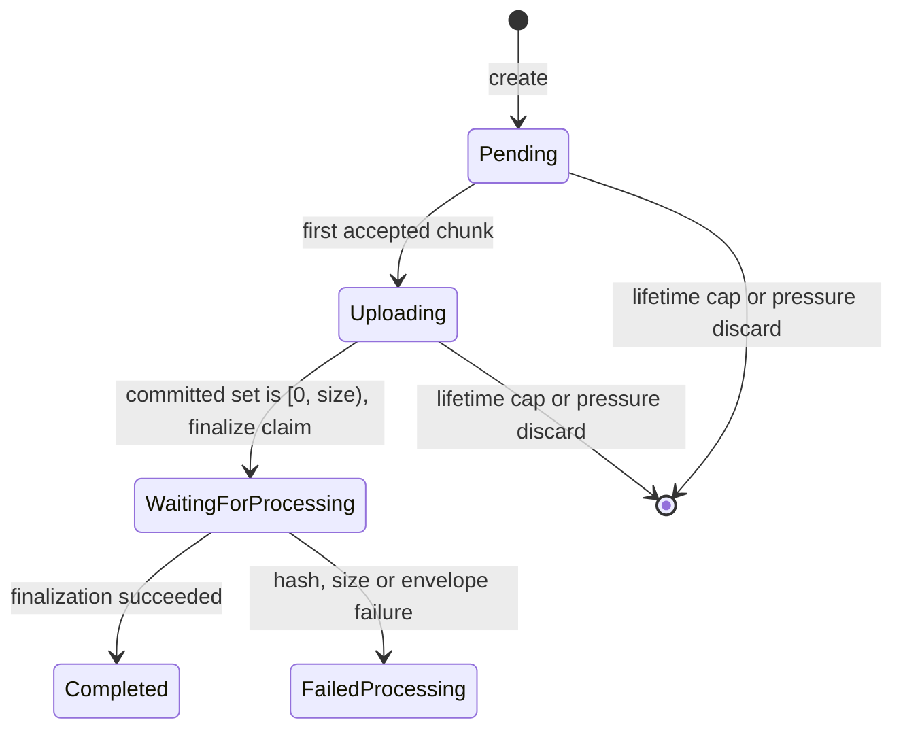

The client-to-server half of the , bound by its invariants (). It borrows the `PATCH` shape of TUS v1, generalised from an append offset to a byte range on a fixed grid, without claiming compatibility. Server: `capsule-server::upload`; client: `capsule-sdk::upload`. Shapes, headers and status codes are the generated  reference, constants are `capsule-server::limits`, and this page fixes their semantics.

## What Gets Uploaded

The client encrypts and signs everything before transmission; the server never decodes, extracts or thumbnails. One asset is a **bundle** of blobs, each its own session with its own upload id:

- **original** — the source, under the bulk AEAD () with the STREAM construction ().
- **derivative** — thumbnails and previews (), each encrypted independently.
- **metadata** — the encrypted CBOR metadata document (), including the LQIP ().
- **provenance** — the asset's signed manifest (), the one non-ciphertext member: server-visible signed CBOR, stored and served byte-for-byte.
- **derivative_manifest** — the signed `DerivativeManifest` for one derivative tier ().
- **backup** — a backup artifact (), covered by the library-level backup manifest instead of per-asset provenance.

Every session declares its `blob_role`, a closed enum, at creation, so the server can reason about bundle completeness without a key. "Blob" is defined in .

- **No wire ordering for a `create`.** Members land in any order into an invisible pending asset, which becomes **visible** to other devices once its **provenance and metadata blobs** are finalized (`capsule-server::upload::visibility`). Whether the original has landed travels separately on the sync feed as `original_held` ().
- **Two manifest paths, never confused.** The `manifest_envelope` on `POST /v1/upload` is a key-free **projection** the server validates (); the signed bytes are the provenance blob. The server MUST NOT serve the projection, or anything re-encoded from it, where a manifest is expected.
- **Derivative format.** A `derivative` session's envelope MUST declare `derivative_role` and `derivative_format`, and every other role is refused them (`error.upload.envelope_mismatch`). A `thumbnail` or `preview` format outside the closed still set is `error.upload.unknown_derivative_format`.
- **Quota.** Every member counts toward the uploader's quota ().

### Replace

Only `create` and `replace` move blob bytes; every other action is a lifecycle write (). A replace mutates an already-visible asset, so:

- It is applied as one act **when its manifest lands**; the other members commit bytes but change nothing observable. The manifest therefore lands **last**, the protocol's only ordering rule: the client opens the manifest's session only once every other member reads `Completed` on `HEAD`.
- The manifest names the bundle it commits to via `original_blob_hash`, required on a replace. An early manifest is refused `409 error.upload.replace_incomplete` and retried.
- Stale-chain and epoch checks (invariants 17 and 18) run inside the index's critical section that re-points roles and mints the sequence number. A stale chain is `409 error.upload.stale_revival`.
- GC collects an abandoned replace's committed-but-unreferenced blobs and credits the quota back.

### Stale-Epoch Create

A `create` is sealed under the album epoch current on the device that wrote it. If the album's epoch has moved past it by the time its manifest lands (imported offline before a rotation, or a sibling sealed under the newer epoch landed first), invariant 18 refuses it at finalization with `error.upload.envelope_rejected`, final for that envelope. The check runs only on a row with no chain head and writes nothing, so a refused create was never published.

The client recovers by **re-sealing** the create at the album's current epoch and pushing it again, once:

- Only a lone, unpublished, key-derived `create` is re-sealed. The refusal must be of its provenance blob, since a later member's refusal can follow a provenance blob that landed. Its chain must hold no later record, and the library no custody receipt for it.
- An epoch rotation is a confidentiality boundary, so everything sealed under the old epoch is sealed again: the original under a fresh `nonce_prefix`, the unchanged signed sidecar under a fresh metadata-blob nonce, and its derivatives regenerated as fresh chains. No prefix or nonce the asset has spent is drawn again, and no blob sealed under the old epoch stays reachable from the library.
- The new genesis keeps the `file_id`, self-verifies before anything is written, and replaces the refused one. A second refusal fails the push.

**Known gap: a device without the new key.** A device learns of a newer epoch only from its own album keystore. If another device rotated the album and the new key has not reached this one, there is no epoch to re-seal at. The push fails as the upload refusal it is, with the server's code and a detail saying there is no newer epoch to re-seal at, and the asset stays local with its original untouched. The detail names no missing key: the server refuses a revoked device, withdrawn write access and a role conflict the same way, and a device holding no newer epoch cannot tell those from a rotation it has not been handed.

## Endpoints

Every endpoint requires a bearer token and the protocol handshake (). Per-endpoint headers and statuses are in .

- `POST /v1/upload` creates a session for a declared ciphertext `size` and `hash`, reserving the pending asset and its quota. An active duplicate returns that session's state instead of a second one.
- `HEAD /v1/upload/{id}` is the resumption primitive: the committed prefix and set, declared length, status, expiry, server advice (), and for `FailedProcessing` the failure's `error.*` code.
- `PATCH /v1/upload/{id}` writes one range.
- `DELETE /v1/upload/{id}` cancels, removing the staged file, session and pending reservation. It is refused `409 error.upload.session_not_active` while finalizing or once terminal. It is serialised with admission, so a range still in flight when its session is deleted is never recorded.
- `GET /v1/upload/sessions` lists the **uploader's** live sessions, for resume. An unknown `?status=` is refused, never ignored.
- `GET /v1/upload/{id}/receipt` returns the session's custody receipt () once `Completed`.

## Chunk Rules and Strictness

Strictness covers the transport: JSON bodies (unknown fields rejected) and headers. Inside signed CBOR, unknown keys are preserved ().

A session's bytes sit on a **4 KiB grid**, a protocol constant. A chunk is a contiguous range of whole grid blocks whose length the client picks per request and may change between requests without changing any address. Sending ranges in order is one valid schedule among many: reordering is the client choosing which range to send next, never a change of layout. These bounds are protocol surface:

- A `PATCH` body MUST be `application/octet-stream` and non-empty.
- `X-Capsule-Offset` names the range's first byte and MUST be a multiple of 4 KiB. The range's length MUST be a multiple of 4 KiB, except a range ending exactly at the declared `size`. A chunk is at most 16 MiB.
- A range that would end past the declared `size` is refused `400 error.upload.size_exceeded` and nothing is written.
- Every `PATCH` MUST carry `X-Capsule-Checksum`, the chunk's SHA-256, which the server verifies **before writing**.
- The server's **committed set**, the coalesced ranges it has made durable, is the only truth. Staged bytes outside it are garbage, whatever the staging file holds.

**Admission** is decided atomically per session against the committed set and the ranges in flight, **before any byte is written**:

| The range is… | Answer |
| --- | --- |
| disjoint from every committed and in-flight range | claimed in flight, written, fsynced, recorded as committed, then `204` |
| wholly inside the committed set | `204` with the session's current state; nothing is written |
| exactly an in-flight range (same offset and length) | waits a bounded time for that attempt to end, then is decided again: a duplicate if it committed, a claim if not |
| overlapping an in-flight range | `409 error.upload.range_conflict` with `X-Capsule-Committed` and `Retry-After`; nothing is written |
| partly committed and partly not | `409 error.upload.range_conflict` with `X-Capsule-Committed`; nothing is written |

No write can touch a committed byte, and no two requests write the same byte concurrently. A claim is released only once every write issued under it has returned, so a write its request abandoned never lands after a retry of the same range commits. A range wholly inside the committed set is a duplicate without any byte comparison. The server keeps no per-write record, and a client that re-sends different bytes over committed ones is told nothing, because those bytes are never written. The source guards () stop a changed source on the client, and the finalize re-hash refuses a blob whose newly committed ranges came from a changed source. The full idempotency contract is .

- **Bounded fan-in.** A session's in-flight cap is fixed at creation, at most 16, and advertised as the advice's `ranges` member on create and `HEAD`. One range more is `409 error.upload.too_many_in_flight` with `Retry-After`, which tells the client to narrow its window rather than back off the lane. A claim lives until its write returns, so a request the client abandoned can hold one for a while.
- **Bounded fragments.** The committed set holds at most 64 fragments after coalescing; a write that would exceed that is `409 error.upload.too_fragmented`, with `Retry-After` when other ranges of the session are in flight, since one may be a claim the client cannot see. Admission counts the fragments the committed set would have with the new range merged, plus one per other range in flight. So with nothing else in flight a gap-filling write is always admissible, and a failed write never leaves more than 64.
- **Lowest gap first.** A client that fills its lowest gap first keeps at most one fragment more than its window, so within the cap it never meets the fragment bound. It can still meet `too_many_in_flight` while the server finishes a write it abandoned, which the `Retry-After` covers.
- The session finalizes automatically when the committed set is exactly `[0, size)`.

## Hostile Clients

The server is friendly to a correct client and assumes any client may be broken, outdated or malicious. No request, request sequence or connection behaviour may corrupt stored data, wedge another request's session, exhaust shared resources, or reveal whether a session it does not own exists.

- **A session never wedges.** Admission to one session is serialised; admitted disjoint ranges are written concurrently. A failed or partial write (I/O error, full disk, dropped connection mid-body) releases its claim and commits nothing, so the retry of the same range succeeds.
- **No request waits on finalization.** The completing `PATCH` and every `HEAD` answer with the status as it stands and never hold the request open for a re-hash, so a slow disk never turns a large upload into a proxy timeout.
- **Disk full is the client's to wait out, not a server fault.** `ENOSPC` is `507 error.upload.storage_full`; a blob store or index outage is `503 error.upload.unavailable` with `Retry-After`. `500 error.upload.storage_inconsistent` is reserved for a state the server cannot explain and is logged at `ERROR`.
- **Bounded per client.** Session creation and chunk writes are rate-limited per account and per source address (`429` with `Retry-After`), and live sessions per account are capped. The source address is the client the deployment's trusted proxies resolve, never a forwarding header taken on its word. The account's budget is charged first, so a request it refuses spends nothing of the address's budget, which other accounts behind that address share.
- **Bounded per connection.** Header and idle timeouts close a connection that sends too slowly. A chunk body is cut when it **stalls** (no bytes for the stall bound) or falls below a minimum sustained rate, never for its total duration, so a link sustaining the minimum rate finishes any chunk. A cut chunk is `408 error.upload.chunk_timeout` and commits nothing. A request body is never buffered beyond the chunk maximum.
- **Requests never panic.** Every reachable failure is a typed rejection. A handler panic is a bug, caught at the router and answered `500` without leaking state.
- **Foreign is unknown.** Another account's session is the same `404` as one that never existed, and only the uploader may write to a session. An upload id is never authority on its own: every request also carries the uploader's credential. A session is bound to its uploader's account, never to an access token, so refreshing a token never ends an upload.
- **Every rejection is logged** with the upload id, account, offset and code, so a misbehaving client is diagnosable from the server alone.

### Protocol Versioning

The upload surface is gated once by the protocol handshake (): a date-versioned `X-Capsule-Protocol` with the accepted window advertised on every response (). There is no capability negotiation, and a version outside the window is `426` before anything is reserved. The date is bumped only for an incompatible change: range or admission semantics, the 4 KiB grid, lowering the 16 MiB maximum or the 64-fragment bound, raising the in-flight cap's ceiling of 16, finalization, or the state machine. Server advice () is tunable, not protocol.

A session is frozen at creation: its `size`, `hash`, in-flight cap and protocol version hold until it reaches a terminal state or its cap, and a server upgraded mid-session keeps serving it under them.

## Session State Machine

`WaitingForProcessing` is neither evictable nor cancellable and always reaches a terminal state (). `FailedProcessing` removes the staged bytes and reservation but keeps the status record, so a client whose ACK was lost can read the outcome. Session state lives in the session store (Valkey via [`redis-rs`](https://github.com/redis-rs/redis-rs), or in-memory), never in PostgreSQL ().

## Session Lifetime and Discard

- **Survival floor.** A `Pending` or `Uploading` session survives at least 1 hour after its last accepted chunk, or creation.
- **Cap.** No session outlives 24 hours from creation.
- **Advertised, relative.** Create and `HEAD` state the cap and the floor as seconds remaining (`X-Capsule-Session-Expires-In`, `X-Capsule-Session-Idle-Expires-In`), never as wall-clock instants, so a client with a skewed clock schedules correctly.
- **Discard window.** Between floor and cap the server MAY discard sessions under pressure, least-recently-progressed first.
- **Uniform `404`.** Discarded, expired and never-existent sessions are indistinguishable: `404 error.upload.session_not_found` (rejection mapping: ). The client re-creates the session and restarts that blob, with bounded backoff.
- **Terminal records** are exempt from pressure discard and live to the cap.
- **Startup scrub.** On boot, before boot recovery and before the listener accepts a request:
  - A staged file with no session is deleted. A stage is kept while its session exists in any status.
  - A `Pending` or `Uploading` session whose staged file is missing is discarded as a cancellation is: under its admission turn, with its reservation released and, for a guest drop, its held descriptor taken and the link's reservation given back.
  - `WaitingForProcessing` and terminal sessions are left to finalization () and their cap.
  - There is no length check: the stage is written positionally, so its length says nothing about what is committed.
  - A store that cannot list stages skips the scrub, and one that cannot list or read sessions keeps what it could not read. Either is logged, and the next boot scrubs again.
  - In-flight claims do not survive a restart: a range written but never recorded is outside the committed set and is simply sent again.

## Staging

Each session owns one staged file, sized to the declared `size` and written positionally; there is no per-chunk file and no assembly step. A range's bytes are written at their offset and fsynced, and only then recorded in the committed set and answered `204`. The record is the commit point:

- A write that fails before the record leaves bytes the committed set does not cover, which the next write of that range overwrites.
- A record the session store loses is a range the client sends again. The finalize re-hash, not the record, admits bytes to a content address.
- A discarded or deleted session takes no further record.

Hashing runs off the async reactor. Total in-flight bytes are bounded by the cache limit, with the discard window as the relief valve.

## Finalization and Integrity

Order is the contract (`capsule-server::upload::finalize`):

1. **Claim** — compare-and-set into `WaitingForProcessing`. A loser is not an error: its chunk was accepted and it answers `204`; the outcome is read from `HEAD` or the session list.
2. **Re-hash** the staged file against the declared hash. A mismatch is `FailedProcessing` with `error.upload.content_hash_mismatch`.
3. **Envelope checks** re-run against the current clock and authority, so a device revoked or an album closed since creation does not slip through (`error.upload.envelope_rejected`). A provenance blob is then admitted only as the canonical encoding of a manifest that agrees with the session's envelope and whose `device_sig` verifies under the key the uploader's published directory holds for the unrevoked device it names. The server cannot tell the signing device from another device of the account, so this runs on every provenance blob, delegated or not; a failure is `error.upload.envelope_rejected`.
4. **Commit** — `BlobStore::commit`: atomic rename onto the content address, then directory fsync.
5. **Ledger** — append and fsync the owner ledger entry ().
6. **Record and receipt** — in **one** PostgreSQL transaction, write the blob's index rows (minting the asset's next sequence number) and sign and log the custody receipt (). Both commit or neither does, so there is never an indexed blob without a receipt or a receipt without custody. A failure fails the session and leaves the committed blob unreferenced and collectable. A retry is idempotent: a retry of a write that already committed returns the receipt it has. A `replace` member other than its manifest writes no index row, because the manifest applies the whole bundle, so its receipt is the transaction's only write.
7. `Completed`.

The request that completes the committed set takes the claim and answers `204` with `X-Capsule-Upload-Status: waiting_for_processing`, without waiting for steps 2–7. The client polls `HEAD` with backoff for the outcome, as for any other state. A `FailedProcessing` outcome carries the step's `error.*` code in `X-Capsule-Upload-Error` and in the session list, which leads the client to its recovery row. A guest drop () follows the same rule: its deposit runs detached, and the guest reads the outcome through the drop's status probe under the link capability.

A claim is driven to `Completed` or `FailedProcessing` independent of the request that triggered it:

- A client that disconnects mid-finalize does not stop finalization, and one that disconnects while its completing chunk is being recorded does not stop the claim that follows.
- A session holding every declared byte that nobody claimed (its process died between recording the last chunk and claiming) is claimed by the first request that meets it: a duplicate of any of its ranges, the client's duplicate `create`, or its `HEAD`. Each starts finalization detached and answers `waiting_for_processing`.
- A `create` whose session finalization refused opens a fresh session for the bytes.
- **Boot recovery.** Before the listener accepts a request, the server drives every `WaitingForProcessing` session through the same steps, and finalizes every session left full and unclaimed through the claim, so a client reaching one first is not raced. If the stage was already committed, the committed blob is re-hashed in place of the stage and step 4 is skipped; the later steps are idempotent. A claim with neither a stage nor a committed blob fails.
- There is no claim lease: one process serves a blob root, so every claim listed before it serves belongs to a process that is gone.

The server can verify only ciphertext; the client verifies plaintext on download through STREAM's per-chunk tags. `Completed` is a one-time acknowledgement; standing durability is `/storage/verify` ().

## Idempotency and Resumption

- **Duplicate create** is keyed by `(owner_id, hash, album_id)`. An active session is returned with its state; an already-finalized hash is `409 error.upload.duplicate_blob` naming the existing asset. A `create` for a different asset first adopts the blob ().
- **Resume** is `HEAD`-driven. A sequential client reads the committed prefix; an out-of-order one reads the committed set, a comma-separated list of inclusive byte ranges such as `0-1048575,2097152-4194303`, never longer than the fragment bound. The client re-plans from the committed set it reads, never from its own record of what it sent. Interrupted transfers are normal, and arbitrary pauses within the lifetime are tolerated.
- **Lost chunk ACK.** After a transport error the client re-sends the same bytes or reads the session state before sending anything else. A re-send of a range that committed, whole or resized within it, is a duplicate. A re-send of exactly the same range while the first attempt is in flight waits for it and is then a duplicate or a write; it is a `range_conflict` with `Retry-After` only if the attempt outlasts the server's bounded wait. None fails the blob.
- **Lost finalization ACK.** `HEAD` or the session list shows the terminal outcome.
- Every step is logged with the upload id.

Client recovery matrix (`capsule-sdk::upload`):

| Code | Client action |
| --- | --- |
| `error.upload.range_conflict` | Re-plan from the committed set the refusal carries (or `HEAD`), after its `Retry-After` when it names one |
| `error.upload.too_fragmented` | Let its own in-flight ranges finish and wait its `Retry-After` when it names one, then re-plan to fill the lowest gap first |
| `error.upload.too_many_in_flight` | Wait its `Retry-After`, narrow the session's window to the advertised `ranges` and to the ranges it still had in flight, then continue |
| `error.upload.content_hash_mismatch` (on `HEAD`) | Check the source identity. Changed: fail the blob with the client's own `error.upload.source_changed` and cancel the session. Affirmed unchanged: re-create the session once. Not affirmable: fail the blob with the refusal and send nothing again, since re-sealed bytes that differ would reuse the original's STREAM nonces |
| a lost answer (reset, or no response within the response wait) | Read `HEAD` before sending anything again, then re-plan from its committed set |
| a session gone (`404` on `HEAD`) before finalization | Re-create the session, restart the blob |
| `error.upload.checksum_mismatch` | Re-send the same chunk |
| `error.upload.chunk_timeout` (`408`) | Re-send the same offset with a shorter range () |
| `error.upload.session_not_found` | Re-create the session, restart the blob |
| `error.upload.duplicate_blob` | Resolve as a merge () |
| `error.upload.replace_incomplete` | Upload the rest of the bundle, retry the manifest |
| `error.upload.stale_revival` | Re-read the asset and rebase |
| `error.request.too_early` (`425`) | Re-send the same request once the handshake completes, outside early data () |
| `error.protocol.version_unsupported` (`426`) | Stop; prompt to update |
| `error.quota.exceeded` | Pause; surface the remediable state |
| `error.upload.rate_limited`, `unavailable`, `storage_full` | Back off per `Retry-After`, then resume from `HEAD` |
| `error.upload.storage_inconsistent` (`500`), and any other `5xx`, `408` or `425`, coded or not | Back off per `Retry-After` (else the retry engine's backoff), then resume from `HEAD` |
| other `4xx` | Fail the blob; never retry unchanged |

With several ranges in flight, a row that waits, reads `HEAD` or re-creates the session is taken once every range in flight has returned, and ranges refused together share one wait. The client also guards its source and its own view of the session:

- **Source identity** (size, modification time and file id recorded when the bundle was built) is checked before every window is read and again after an original's window is sealed. A change ends the blob as `error.upload.source_changed` with nothing more of it sent.
- **Chunk tags.** An original's read also derives every whole STREAM chunk the range touches and compares each tag with the one its bundle recorded. A mismatch ends the blob the same way, before any of that read is sent.
- **Re-reads.** A range overlapping bytes the transfer already read (after a lost answer, a re-plan, a lost range record, a re-created session, or in a session resumed from before the transfer) is read again only when that check, made just before the read, affirms the source is unchanged. A source that cannot affirm it ends the blob the same way, since re-sealing different bytes would put a second ciphertext under the original's STREAM nonces.
- **Server truth wins.** Every answer the client folds in only grows what it believes is committed, until a `HEAD` restates it. A session whose answers all came back but whose last state is still `uploading` is read from `HEAD` before it is called complete, so a record the server lost is sent again.
- **Bounded loss.** Each `HEAD` holding less than the server already acknowledged, mid-transfer or at finalization, costs one recovery from the transfer's budget, which progress does not refill. A server that keeps losing acknowledged ranges ends the blob as retries exhausted rather than restarting it forever.

Every non-success answer to a create, a chunk or a `HEAD` is classified before anything is retried (): a code with a row above takes that row's action whatever its status, and a code naming no action is classified by its status. Each wait charges the transfer's recovery cap and its server lane's shared retry budget, so a server that never stops failing ends the transfer. The transfer gives up with the last answer's status and stable code, so the client still localizes what the server said. A chunk answered with a `5xx` may have been kept, so its wait always resumes from `HEAD`, never from the client's own offset. A completing chunk answered `500 storage_inconsistent` settles on the state `HEAD` reports: `completed` with no byte re-sent, `failed_processing` with its code, or the offset to resume from.

## Adaptive Chunk Sizing

The server enforces bounds by rejection only and never adapts. `capsule-sdk::upload` adapts: it starts from the advised size clamped to its own bounds, measures goodput over a sliding window, doubles or halves after a warm-up, and keeps every candidate a 4 KiB multiple by construction. Because the server cuts only a stalled chunk, a chunk never has to fit a total-time deadline. The client sizes a chunk to complete in a target request duration at the measured goodput, which bounds what one lost request costs and keeps the round trip a small share of each request. Under an adverse connection () the target duration is shorter. A `408 error.upload.chunk_timeout` means the link stalled: the client re-sends the same offset with a shorter range and does not grow again until a run of successes shows the link recovered. Each re-send charges the transfer's bounded recovery budget.

Which ranges are in flight, and in what order, is the client's schedule, never protocol. Per session the client keeps at most the in-flight window of , never above the session's advertised cap, and fills the lowest gap first, so a sequential schedule is a window of one. Across blobs, the pipeline decides what to start ().

## Error Taxonomy

Clients branch on `error.*` codes (), never on bare statuses. The status mapping is the shared error contract (), and the authoritative list per endpoint is . Unprefixed codes below are `error.upload.*`.

| Status | Codes |
| --- | --- |
| `400` | `malformed_request`, `unknown_crypto_suite`, `invalid_hash`, `invalid_size`, `unsupported_content_type`, `unknown_derivative_format`, `envelope_mismatch`, `timestamp_out_of_range`, `invalid_action`, `empty_chunk`, `chunk_not_aligned`, `missing_offset`, `missing_checksum`, `checksum_mismatch`, `size_exceeded`, `content_hash_mismatch`, `envelope_rejected`, `invalid_status_filter` |
| `403` | `album_access_denied`, `device_not_authorized`, `owner_not_permitted`, `error.quota.exceeded` |
| `404` | `session_not_found` |
| `408` | `chunk_timeout` |
| `409` | `duplicate_blob`, `range_conflict`, `too_fragmented`, `too_many_in_flight`, `session_not_active`, `receipt_not_available`, `replace_incomplete`, `stale_revival` |
| `413` | `file_too_large`, `chunk_too_large` |
| `415` | `unsupported_media_type` |
| `425` | `error.request.too_early` |
| `426` | `error.protocol.version_unsupported` |
| `429` | `rate_limited` |
| `500` | `storage_inconsistent` |
| `503` | `unavailable` |
| `507` | `storage_full` |

## Deduplication and Merge

Blobs are content-addressed, so identical bytes are stored once. A finalized hash on create is `409 duplicate_blob` naming the existing asset, which for a retry of the same blob means it is complete. An asset that already exists remotely under a different ciphertext is admitted by the import pipeline () and MUST resolve as a **merge**: the existing blob is linked to the new asset reference, never re-uploaded. A merge is strictly additive: it never deletes a blob or rewrites a manifest, and references are removed only by a signed `delete` ().

The server performs the link. A `create` whose hash another asset of the same owner and album already holds is **adopted** before it is refused: the existing blob is recorded against the requesting asset, with the same owner-ledger entries and custody receipt a finalization writes, and only then is the `409` returned. Every asset that depends on a blob is therefore a row naming it, which is what garbage collection () counts, so purging one holder never collects bytes another still references. Adoption never stores bytes and is never charged against quota. It does not apply to:

- a retry of the same asset, which already names the blob;
- a `replace` member, whose manifest records the whole bundle;
- a signed manifest, which names its own asset;
- bytes the store no longer holds, for which the create opens an ordinary session so they can be uploaded again.

An adoption that would re-point a singular role the asset already holds is `400 error.upload.envelope_mismatch`, the same answer finalization gives.

Duplicates already in a library are collapsed by intra-library deduplication ().

## Quota and Permissions

- An upload is charged to `upload_user_id` (the uploader), distinct from `owner_id`, and uploading for another owner requires a verified relationship. Quota is reserved for the declared `size` at session creation, after the duplicate check, and released when the session is deleted, discarded, expired or ends in `FailedProcessing` ().
- Adding to an album requires write-tier access. Asset uploads always carry a concrete `album_id` (the user's choice or the default album, ), because the bytes are encrypted under that album's key.
- Only the uploader may `PATCH`. The uploader or owner may `HEAD` or `DELETE`; to anyone else the session does not exist (`404`).
- The uploading device need not be the manifest's signing device: any device of the same account may upload a bundle another device sealed and signed (). The signature is verified against the signer, never the uploader.

## Upload Tiering (Staged Uploads)

A per-device **upload policy** orders sessions; the server has no mode branch.

- **`full`** (default) — every session of a bundle is eligible at once, within the in-flight windows (), on a connection that permits bulk transfers. On any other connection a push runs `staged`, since the cache plan () defers bulk work.
- **`staged`** — sessions open in tier order per asset:

| Tier | Roles | Opens when |
| --- | --- | --- |
| **T0 — index** | provenance + metadata | any usable connection |
| **T1 — preview** | derivatives (+ derivative manifests) | any non-metered connection |
| **T2 — original** | original | unmetered Wi-Fi, or explicit force-sync |

T0 is exactly the visibility gate, so a staged asset is visible to other devices as soon as T0 finalizes, in the awaiting-original state (). Connection rules are . Types: `capsule-core::import::upload`; scheduler: `capsule-sdk::staged`.

- A staged asset pins its local original until T2 is custody-confirmed ().
- Staged and streaming import () are mutually exclusive per import; the planner rejects the combination.
- Each tier's sessions are charged at their own creation.
- Deleting an asset whose upload has not finished, an awaiting-original one included, redacts it before its `delete` is sent (). Every open session `GET /v1/upload/sessions` lists for the asset's `asset_id` is cancelled with `DELETE /v1/upload/{id}`, and no pending tier of a trashed asset is opened. A session already finalizing answers `409 error.upload.session_not_active`, which is not a failure: its blob lands, and the `delete` sent after it supersedes the create it completes.
- Resume re-derives the tier queue from server truth: held roles on the feed entry plus `GET /v1/upload/sessions`.

Streaming import uses these same sessions unchanged, one bounded window at a time; only the drive pattern differs.

## Queueing Across Servers

The upload queue is the client's, not the server's, and holds every tier a device uploads, from T0 records to originals, video and derivatives. A device signed in to more than one server (say, two accounts on different self-hosted servers) keeps one **lane** per server, keyed by the server's canonical origin. Scheduler: `capsule-sdk::upload::queue`. The queue keeps four properties:

- **Per-server lanes.** Each lane has its own sessions, backoff, negotiated protocol window () and `Retry-After` deadline, so a `429`, an outage or a stall at one server never delays work bound for another.
- **Two in-flight windows per lane.** A lane holds up to **W** sessions open at once, and each session up to **P** ranges in flight. Both are client-local, capped by bounds compiled into the client and lowered by the server's advice (), and W never exceeds the account's live-session cap. They are not the protocol window. P above one applies only to a source that re-verifies every range it derives against what it first produced: bytes held in memory, or an original checked by its chunk tags (). Any other source is sent one range at a time, because a parallel schedule re-sends ranges far more often. Several sessions in flight, each on its own connection, keep a high-latency or lossy link busy, since one connection's throughput is bounded by its round trip and loss rate, however large its chunks.
- **One shared, bounded memory budget.** Every range in flight reserves its length against one device-wide byte budget, so adding a server divides the budget and never multiplies it. A blob's size reserves nothing, because a push holds only the windows it is sending (bounded memory: ). A lane whose transfers report no progress for the stall bound has its reservations revoked: its work returns to the front of its queue, and the lane is not served again for one more stall bound.
- **Fair scheduling.** Lanes are served round-robin, and a lane always serves its lowest tier first and never skips its own head, so the tier order () holds per server and one lane's T0 work is never starved by another's T2 originals.
- **Rebuildable state.** On resume, each lane re-derives what remains from the local index (the Live assets that should reach that server, with this device's own upload of a trashed asset kept redacted, ) and from its own server's truth (held roles on its feed plus its `GET /v1/upload/sessions`), as a single-server queue does. No lane's queue is derived from another server's, and losing the queue loses no work.

With one server the queue is one lane.

A delegation hand-off () is not a lane: the delegate pulls the bundle over the peer channel and uploads it from its own queue. Every album has exactly one home server, which takes every write to it, and multi-writer albums across servers are not part of v1 (). An asset is therefore only ever queued for its album's home server.
