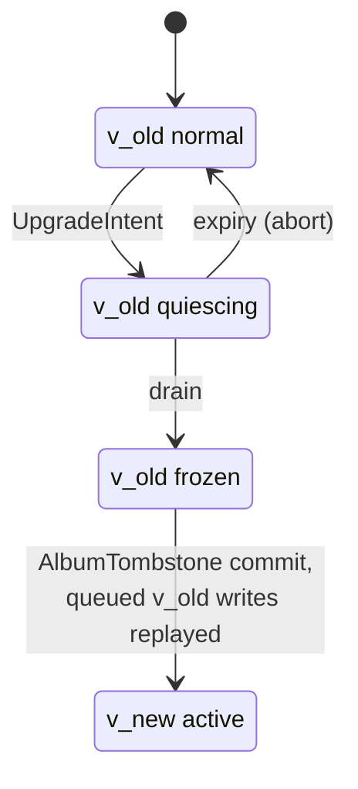

Any server may meet any client: an app months older than its server, a server older than a freshly updated app, a federated peer on code Capsule never shipped. Both sides hold data the other cannot recreate: the client its keys and unsynced edits, the server the only copy of uploaded ciphertext. This page fixes the rules that keep every pairing safe: **reads stay compatible forever, writes fail closed, and nothing is ever dropped to resolve a mismatch.**

## System Invariants

Every client and server implementation, of any version, MUST uphold these. Together they make the worst outcome of any version mismatch a refused write, never lost or corrupted data.  lists the ways an implementation can still lose or corrupt data while every check passes, and the test that guards each.

1. **Bytes are immutable and content-addressed.** A blob is named by the hash of its bytes and never changes, so its identity does not depend on any protocol version ().
2. **Every signed record leads with its version, and unknown fields survive.** A record's schema version is decoded before anything else. Fields a reader does not know are kept verbatim, re-emitted canonically and covered by the signature, so stripping one fails verification ().
3. **Never write what you do not understand.** A component that meets a record version, enum value, `crypto_suite_id` or `sidecar_schema` above what it implements may read and store it verbatim, but MUST NOT modify, re-sign or re-encode it. Reads of any version it does understand stay supported forever.
4. **The server never rewrites client-signed data.** It stores and serves signed manifests and sealed blobs byte for byte. Data leaves the server only through a signed lifecycle action followed by garbage collection after a grace window.
5. **A client never discards data to resolve a mismatch.** An entry it cannot apply is quarantined, a write it cannot send is queued, and a catalog newer than the binary is refused and left untouched. Each resumes after the user updates.
6. **Concurrent edits converge deterministically.** Metadata merges by CRDT (); album membership and moves are ordered by MLS commit order. No merge depends on wall-clock agreement between devices or on which side is newer.
7. **Local originals are released only on server custody**: a durable verdict, a signed custody receipt and a matching read-back hash (). A copy on another device, including a delegate (), is never custody.
8. **One protocol version per binary.** A client sends the same `protocol_version` on every request it makes, and that value comes from one constant ().
9. **Evolution is additive.** New fields are optional and absent from the wire until set; new behaviour is a new `protocol_version`. A change no window can span goes through the album upgrade ceremony (), never an in-place rewrite.

## Version Identifiers

| Identifier | Carried on | Owner |
| --- | --- | --- |
| `protocol_version` (`YYYY-MM-DD`) | every request, every album pin |  |
| `crypto_suite_id` | every manifest and metadata blob |  |
| `sidecar_schema` | every sidecar, key 0 |  |
| provenance record version | every provenance record, leading field |  |
| client build (semver) | `X-Capsule-Min-Client-Build` floor in every response |  |
| catalog `PRAGMA user_version` | the client's SQLite catalog |  |
| server schema migrations | PostgreSQL `seaql_migrations` |  |

### Protocol Version Source

The protocol date a build speaks is one constant, `PROTOCOL_VERSION` in `capsule-core::crypto::primitives`. Every client and every test that means "this build's protocol" reads it from there.

- **Exported, never restated.** The core exports it over UniFFI and over wasm (`capsule-wasm`), so Swift, Kotlin and the web client read the value instead of typing it. No client source holds a protocol date literal. Test fixtures that pin a historical date are the one exception.
- **Never a parameter.** No API takes the protocol date as an argument. The transport sets `X-Capsule-Protocol` from the constant on every request, generated and hand-written alike. A per-call or per-client argument would let one binary send two dates, which invariant 8 forbids.
- **Checked in CI.** A gate fails on a protocol-date literal in client source outside fixtures. Each client's tests assert that the header it sends equals the exported constant.

## Update Policy

**Servers update first.** A server release accepts a closed window `[Min, Max]` of `protocol_version` values and advertises it on every response. The window MUST include every version spoken by an app release still inside its support period, so a staggered app rollout never strands a user. A version leaves the window only through the deprecation policy (): announced ahead, after which writes from it are refused with `426` and reads keep working.

**Apps stay lenient.** A native app must work against any server whose window contains its version, and treats every unknown response field as preserved data, not an error. It refuses to write, and tells the user to update, when the server answers `426` or advertises a minimum client build above its own. The web client () is the one exception: it is served by its own server and assumes that server's exact version.

**Server upgrades are forward-only.** Migrations run before `serve` (which refuses an unmigrated schema), never downgrade, and are preceded by a backup. A failed migration means restoring the backup, never rolling back and continuing.

**Compatibility is checked on every request.** The server gates every request against its window and answers every response with it. The client latches the window each response advertises, per origin, and refuses a write the latched window already refuses before it leaves, with the same typed upgrade error a server `426` produces. Neither side soft-degrades: a write outside the window fails loudly, and both sides agree on `protocol_version`, `crypto_suite_id` and `sidecar_schema` for every operation that proceeds.

## Client Catalog Migration

The client catalog is the library as the user experiences it, so it carries the server schema's obligation: a **forward-only stepwise migrator keyed on `PRAGMA user_version`**, one step per version, no downgrade. Rebuilding from sidecars is the repair path for a known-inconsistent index (), not a migration strategy: it can only return what the sidecars carry. The derived cache (thumbnails, previews) is dropped and regenerated instead of migrated.

A catalog stamped **above** the binary's version is refused with an error naming both versions and left byte-for-byte untouched (invariant 5). An older binary writing to it would fill columns it does not know are authoritative; refusing costs the user an update.

The CLI's own database, `capsule.sqlite` (the sync store and peering's directory floor and tombstones), follows the same rule with its own `user_version` migrator. A copy written by an earlier sea-orm build is adopted in place, in one transaction, and one listing a migration this build does not know is refused untouched rather than recreated, so peering state is never discarded.

## Album Protocol Version Pinning

Each album declares a `protocol_version` at creation, immutable for its lifetime, and every event in it must conform. A faulty implementation of a newer version can therefore only corrupt albums of that version, which matters most under .

- A client below the server's `Min` cannot write to any album.
- A client below an album's pin cannot write to that album, even if the server still accepts its version elsewhere.
- Reads are never affected by either rule.

## Album Upgrade Ceremony

An album moves to a newer version by **tombstone plus fork**: the old album freezes, a new album at the target version is forked from its frozen state, and members move over. It is atomic per client and resumable, and every step is keyed by an `intent_id` (UUIDv7) so a retried or contradictory proposal can never produce two forks.

1. **Propose.** One of the album owner's devices sends `UpgradeIntent { from_version, to_version, intent_id, proposer_device, deadline }`, signed by its device key, under the owner's session. `deadline` is a duration of at most 7 days, and the server refuses a longer one. Expiry is measured on the server's clock. Only one intent may be live per album. Any of the owner's devices that holds the live `intent_id` can abort it, so one compromised device cannot hold an album read-only past an abort by another.
2. **Quiesce.** Members queue new writes locally, flagged with the `intent_id`. The server refuses writes that do not name the live `intent_id` (`409 error.upload.album_quiescing`).
3. **Drain.** The ceremony waits until no upload session against the album is in flight. On expiry it aborts by absence of state, and queued writes return to the old album.
4. **Tombstone.** The proposing device commits `AlbumTombstone { intent_id, frozen_state_hash }`, a hash over the album's members, accepted manifests and provenance head. Every member recomputes it; a mismatch aborts the upgrade for that member.
5. **Fork.** A new album at `to_version` references the existing ciphertext by content hash, with no re-encryption. Its manifests carry `upgraded_from { old_album_id, intent_id, frozen_state_hash }` in the signed core, and fresh album keys are minted.
6. **Replay.** Each member re-encodes its queued writes for `to_version` and replays them.
7. **Resume.** A client that crashed mid-ceremony reads its local pending state and the album's phase from the server and continues from there.

The server does only what clients cannot do themselves: verifying the proposer against the account's device directory (), the expiry clock, the write filter and the drain count (upgrade routes in ). It never judges `frozen_state_hash`, which is each member's independent statement about its own view.

## Known Gaps

- **The protocol date is restated.** The web client (`capsule-web/src/lib/api.ts`) and the Android app (`ServerSessions.kt`) type the literal. Neither UniFFI nor wasm exports the constant. The FFI client constructor and every generated gated operation take the date as an argument, and the hand-written upload path sends the constructor's value rather than the constant's. No CI gate compares them.
- **The upgrade deadline is unbounded.** The server accepts any `deadline`.

## Validation

Each invariant above has an automated test at the layer that owns it (). The version-specific ones:

- A request outside the window is refused with `426` on every route class, and the client surfaces one typed upgrade error.
- Golden records and wire messages from every released protocol version still decode, verify and round-trip byte-identically, unknown fields included.
- An older reader handed a newer record stores it verbatim and refuses to modify it.
- A catalog at every historical `user_version` migrates to the current one; a newer catalog is refused untouched.
- The upgrade ceremony survives a crash after the tombstone without a second fork, and a divergent member aborts it cleanly with no queued write lost.
- A client that sends a date other than the exported constant fails its platform's tests, and CI fails on a protocol-date literal in client source.
- An `UpgradeIntent` whose `deadline` exceeds the bound is refused.
