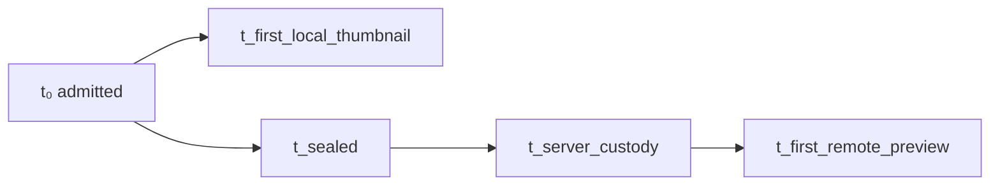

This page owns how Capsule measures speed and memory: the metrics on the path from starting an import to seeing processed content, where each one is measured, the benchmark harnesses, the policy that decides when an optimisation may land, and the scale targets. It defers the responsiveness parity benchmark and its frame bounds to , the hidden metrics page every client carries to , the pipeline stages to , and the render ladder to .

Two rules hold throughout:

- **Every number on this page is unmeasured until a benchmark fills it.** A target with no run behind it is a goal, not a claim, and nothing here may be quoted in the README or user docs until its status is _measured_.
- **No optimisation without a measured A/B** ().

## Upload-to-Preview Chain

The owner's goal is the shortest time from the user starting an import to seeing processed content. Most of the chain is local: an import shows its own thumbnail without a server, per . The chain is measured per asset, from **t₀**, the moment the executor admits the asset (`CandidateStarted` in `capsule-library::import::progress`). Each run also reports the **first asset of the run** measured from plan confirmation, because that is what a user waits for.

| Metric                    | Ends when                                                                                                                                        | Pipeline boundary                                                                                                                                                     | Measured by                                                                                                                                                                             |
| ------------------------- | ------------------------------------------------------------------------------------------------------------------------------------------------ | --------------------------------------------------------------------------------------------------------------------------------------------------------------------- | --------------------------------------------------------------------------------------------------------------------------------------------------------------------------------------- |
| `t_first_local_thumbnail` | The importing device draws the asset's Thumbnail rung (an encoded tier or an embedded preview standing in for it) in a visible cell.             |  step 3, derivatives, in `Workspace::prepare_still` (`capsule-library/src/lifecycle/derivatives.rs:387`)                          | Rust stamps the stage; native code stamps the frame.                                                                                                                                    |
| `t_sealed`                | The signed create commit returns: original encrypted, fsynced and renamed, sidecar sealed, manifest signed and self-verified, index row written. | Execute step 2, `Workspace::commit_signed_create` (`capsule-library/src/lifecycle/import.rs:811`)                                                                     | Rust                                                                                                                                                                                    |
| `t_server_custody`        | Every blob of the asset's bundle holds a verified custody receipt ().                           | Execute step 4: `Workspace::upload_bundle` (`capsule-library/src/lifecycle/upload.rs:622`), then the SDK's `Receipt` transfer event (`capsule-sdk/src/events.rs:180`) | Rust                                                                                                                                                                                    |
| `t_first_remote_preview`  | A second enrolled device, already synced and in the foreground, draws the asset's Thumbnail rung fetched from the server.                        | The SDK's `FetchVerified` event (`capsule-sdk/src/events.rs:222`) for the thumbnail blob, then decode and frame                                                       | Rust for the fetch; the second device's native code for the frame. The two clocks are not compared: the second device reports its own interval from the sync feed announcing the asset. |
| Decode ms                 | One decode of one rung, per format and tier.                                                                                                     | The sandboxed decoder () or the in-process decode it stands in for                                                              | Native (`CapsuleSignpost.imagePipeline` on Apple); `capsule-core::media` for Rust-side decodes                                                                                          |
| Peak RSS                  | The process's high-water resident memory over the run.                                                                                           | Whole run                                                                                                                                                             | Native only. Rust cannot see the host process's memory honestly.                                                                                                                        |
| Queue depth               | Assets admitted and not yet sealed, and blobs sealed and not yet in custody, sampled.                                                            | Executor and upload queue                                                                                                                                             | Rust                                                                                                                                                                                    |
| Frame time                | Per-frame duration and missed deadlines while the chain runs, so an import that janks the grid is visible.                                       | UI thread                                                                                                                                                             | Native (JankStats on Android, the `inputToFrame` and hitch signposts on Apple)                                                                                                          |

Definitions that make the numbers comparable:

- **Percentiles, not means.** Every `t_` metric is reported as p50 and p95 over the run's assets, plus the first asset. Means hide the slow tail a user notices.
- **Per format.** A run reports each metric per source format (JPEG, HEIC, the RAW families, video), because a RAW decode and a JPEG decode are different budgets.
- **Monotonic clocks only.** Stage stamps are monotonic elapsed time from an injected clock, never wall-clock, so tests replay them deterministically ().

### Typed Stage Events and the Diagnostics Snapshot

Rust MUST emit typed per-stage progress events and expose a pull-based diagnostics snapshot. The pipeline doc already promises a per-stage event stream (), and today the code emits only run- and candidate-level events.

- **Stage events.** The import progress stream gains a stage-transition event per asset: which stage started or finished (scan, encrypt, derive, seal, index, upload, custody), the asset id, and the monotonic elapsed time. Upload and custody stages reuse the existing transfer event stream's contract: zero cost when nobody listens, a transfer never waits on its observer, deterministic order, and no plaintext or key material in any event (`capsule-sdk/src/events.rs:1-30`).
- **`diagnostics_snapshot()`.** One FFI and wasm call returning, at the moment of the call: queue depths per priority class, bytes in flight, per-stage latency histograms (p50/p95 since the snapshot was last reset), counters for retries, integrity rejections and deferred derivatives, and the active connection class. It is a pull API so a closed metrics page costs nothing.
- **Native merges.** The native client adds what only it can measure (peak RSS, decode ms, frame time) and renders the result on the developer metrics page ().

Status: **Planned.** Stage events and the snapshot do not exist yet ().

## On-Device Metrics, No Telemetry

Metrics never leave the device. There is no telemetry upload, no third-party APM and no analytics SDK, on any client.

- **Native code owns memory, decode and frames.** On Apple, `CapsuleSignpost` (`capsule-swift/Modules/CapsuleFoundation/Sources/CapsuleSignpost.swift`) names the signpost categories for image-pipeline, catalog, import and input-to-frame intervals, and MetricKit supplies field memory, hang and launch metrics. On Android, `FrameMonitor` (`capsule-android/src/main/kotlin/com/justin13888/capsule/perf/FrameMonitor.kt`) summarises JankStats frames into a structured `capsule.perf` log line per window.
- **Rust owns pipeline and transfer timings**, through the stage events and `diagnostics_snapshot()` above.
- **The page.** Every client carries a hidden Developer → Live metrics page that renders the merged snapshot in real time. Its client contract (how it is reached, what it shows, that it is hidden by default) is owned by .
- **Logs stay structured.** Every metric that is also logged is a key-value line a user can attach to a bug report by hand ().

## Benchmarks

| Harness                      | Measures                                                                                                                                                             | Where                                                                                                                                                     | Status                                          |
| ---------------------------- | -------------------------------------------------------------------------------------------------------------------------------------------------------------------- | --------------------------------------------------------------------------------------------------------------------------------------------------------- | ----------------------------------------------- |
| Responsiveness parity        | Cold start to first thumbnail, scroll frame rate and dropped frames, full-resolution open, input-to-frame, against the platform photo app on a 100,000-asset library | `xtask/src/bench_apps.rs`, `mise run bench-apps`, `.github/workflows/bench-apps.yml` (manual, self-hosted). Contract:  | Implemented; no device baseline is recorded yet |
| Rust micro and macro benches | Hot functions (hashing, STREAM sealing, CBOR, CRDT merge, planner) and one-asset pipeline runs over the fixture corpus                                               | divan, in each crate's `benches/`                                                                                                                         | Planned                                         |
| Upload-to-preview            | The  metrics on a fixed corpus, CLI-driven, against a local server                                                                       | `capsule-e2e` plus the stage events                                                                                                                       | Planned                                         |
| Scale                        | The  phases on a synthetic multi-million-asset library                                                                                           | xtask, seeded generator                                                                                                                                   | Planned                                         |
| Server soak                  | RSS, latency and fsync time over hours of mixed upload and fetch load                                                                                                | Staging cluster                                                                                                                                           | Planned                                         |

**divan is the Rust benchmark harness** for the main workspace. It runs benches as plain functions with allocation counting built in, which is what an allocator or arena A/B needs. Rawshift is a separate repository and keeps its own Criterion benches (`rawshift-image`'s `benches/`). No workspace crate has a bench target today.

A benchmark result is a JSON document naming its harness, build, device or host profile and library size, judged against a committed baseline for that profile, the way `bench-apps` already does. Results from another profile are refused, never compared.

### Scale Benchmark

The README says Capsule organizes millions of photos. That claim MUST be backed by a reproducible benchmark before it is repeated anywhere else.

- **Library.** A seeded generator writes a synthetic library of real, signed, encrypted assets: small real image payloads, realistic capture-time and GPS distributions (bursts, trips, dense home clusters), stacks, labels, albums and captions. The same seed produces the same library byte for byte. Sizes: 100,000 (the parity size), 1,000,000 and 5,000,000; 10,000,000 is the stretch tier ().
- **Phases**, each timed and with peak RSS recorded:
  1. **Import**: throughput and the chain's p95 over the whole library, CLI-driven.
  2. **Timeline scroll**: open, jump to an arbitrary year and fling, on the parity harness.
  3. **Search**: a fixed query set over the text grammar (), cold and warm.
  4. **Places clustering**: clusters at every zoom level over the whole library ().
  5. **Sync**: a fresh device catching up the library's metadata, and an enrolled device applying a 10,000-change delta.
- **Hardware profiles.** A reference desktop and server for import and sync, and the parity bench devices for scroll, search and places.

## Measurement Policy

An optimisation that adds code, a dependency or a configuration knob lands only with a measured A/B in its pull request: the same build with and without the change, on the same profile, interleaved runs, medians and p95 with their spread, and a win larger than the run-to-run noise. A change justified by a benchmark's existence rather than its result is refused.

### Allocator

Server and clients use the **system allocator**. mimalloc or jemalloc replaces it only after heaptrack or dhat shows where allocation time or fragmentation goes, and a staging soak shows the candidate winning on steady-state RSS and tail latency. The soak is the deciding test because allocator differences show up in long-running fragmentation under a multi-threaded Tokio runtime, which a short benchmark cannot see. On the apps, the Rust core is a library inside a host process whose own allocator is the platform's, so a client-side swap changes only Rust's share and needs its own A/B. `capsule-library/src/test_heap.rs` already wraps the system allocator to measure bounded-memory tests, and keeps doing so.

### Arenas and Slabs

An arena, slab or object pool is admitted only on a hot path a profile names, with an A/B showing the allocation win. They trade a simpler ownership model for speed, which is the wrong trade anywhere the profile does not point.

### Blocking on the Async Runtime

The server MUST NOT run blocking or CPU-heavy work on Tokio worker threads ( states the hashing half). Two guards enforce it:

- **Static.** A `clippy.toml` beside `capsule-server/Cargo.toml` lists `disallowed-methods` for blocking calls (`std::fs`, `std::thread::sleep`, synchronous hashing of a whole buffer), with each reviewed exception allowed at the one function that runs inside `spawn_blocking`. Clippy reads the nearest `clippy.toml` and does not merge it with the workspace's, so that file restates the workspace knobs.
- **Dynamic.** Debug builds record each instrumented span's busy time, and a test-only tracing layer fails a smoke test whose single poll exceeds a budget (1 ms). tokio-console is the interactive tool for the same question during development.

The guard has a known first catch: finalize re-hashes staged bytes with SHA-256 inline on the async worker, window by window (`capsule-server/src/upload/finalize.rs:1181-1213`), and the chunk route hashes each chunk inline too (`capsule-server/src/routes/upload.rs:1539`).

### io_uring

Not adopted. The server's per-chunk cost is one `fsync` and one SHA-256 pass (). io_uring cuts syscall submission overhead, which is not where that time goes, and it would bring a second runtime model beside Tokio. Revisit only if a profile shows submission overhead dominating.

## Scale Targets

Status is **unmeasured** for every row until the named benchmark fills it. Targets are p95 unless stated.

| Target                                                                  | Library  | Profile                       | Benchmark         | Status                    |
| ----------------------------------------------------------------------- | -------- | ----------------------------- | ----------------- | ------------------------- |
| Import throughput ≥ 1,000 assets/min (JPEG/HEIC), sealed and in custody | 1M       | Reference desktop, LAN server | Scale: import     | Unmeasured                |
| `t_first_local_thumbnail` < 500 ms for the first asset of a run         | any      | Parity phone                  | Upload-to-preview | Unmeasured                |
| `t_sealed` < 1 s for a 25 MB still                                      | any      | Parity phone                  | Upload-to-preview | Unmeasured                |
| Cold start to first thumbnail no worse than the platform photo app      | 100k, 1M | Parity phone                  | Parity            | Unmeasured                |
| First 100 thumbnails drawn < 100 ms from warm open                      | 1M       | Parity phone                  | Parity            | Unmeasured                |
| Full-resolution open < 500 ms (RAW < 2 s)                               | any      | Parity phone                  | Parity            | Unmeasured                |
| Scroll: no dropped frames beyond the baseline tolerance during a fling  | 1M, 5M   | Parity phone                  | Scale: scroll     | Unmeasured                |
| Search < 200 ms, first results                                          | 1M, 5M   | Parity phone                  | Scale: search     | Unmeasured                |
| Places clusters for any viewport < 100 ms                               | 5M       | Parity phone                  | Scale: places     | Unmeasured                |
| Fresh-device metadata catch-up                                          | 1M       | Parity phone, LAN             | Scale: sync       | Unmeasured, no target yet |
| CRDT merge of one asset's concurrent edits < 100 ms                     | n/a      | Reference desktop             | divan             | Unmeasured                |
| Client peak RSS < 500 MB during import                                  | 1M       | Parity phone                  | Upload-to-preview | Unmeasured                |
| Server steady-state RSS flat over a 24 h soak                           | n/a      | Staging cluster               | Server soak       | Unmeasured                |

### Goals From the Owner's Notes

| Goal                          | Disposition                                                                                                                                                                                                                                                                                      | Status                    |
| ----------------------------- | ------------------------------------------------------------------------------------------------------------------------------------------------------------------------------------------------------------------------------------------------------------------------------------------------ | ------------------------- |
| 10M assets per library        | Stretch tier of the scale benchmark; 1M and 5M gate first                                                                                                                                                                                                                                        | Unmeasured                |
| First 100 thumbnails < 100 ms | Scale target above                                                                                                                                                                                                                                                                               | Unmeasured                |
| Full-res < 500 ms, RAW < 2 s  | Scale target above; the RAW figure depends on Rawshift's decoder                                                                                                                                                                                                                                 | Unmeasured                |
| Search < 200 ms               | Scale target above                                                                                                                                                                                                                                                                               | Unmeasured                |
| Idle CPU < 20%                | Reframed: an idle phone app should cost close to nothing, so the target is no periodic wake-ups and no CPU while nothing is visible or transferring. That target replaces the 20% figure                                                                                                         | Unmeasured                |
| Client RAM < 500 MB           | Scale target above (peak RSS during import)                                                                                                                                                                                                                                                      | Unmeasured                |
| 99.99% availability           | Tracked goal for a server deployment; offline-first clients do not depend on it (). It needs more than one serving replica, which is post-v1 ([ADR-0025](https://github.com/Capsulsaurus/Capsule/blob/master/adr/0025-a-blob-root-has-exactly-one-serving-process.md)) | Unmeasured                |
| 1000 images/min sync          | Scale target above (import throughput to custody)                                                                                                                                                                                                                                                | Unmeasured                |
| Conflict resolution < 100 ms  | Scale target above (CRDT merge)                                                                                                                                                                                                                                                                  | Unmeasured                |
| Self-host setup < 30 min      | A timed walkthrough of  by someone new to it                                                                                                                                                                                                                            | Unmeasured, needs a human |
| "40% better compression"      | Tracked goal. Originals are stored byte-exact, so it depends on the roadmap's format-aware compression, which has no design doc yet; that doc names the baseline                                                                                                                                 | Unmeasured                |
| Plugin architecture           | Not a goal. Third-party code inside a client would sit inside the plaintext boundary                                                                                                                                                                                                             | Dropped                   |
| Webhooks < 100 ms             | Not a v1 goal ()                                                                                                                                                                                                                                                                    | Not a v1 goal             |

### Webhooks

Webhooks are not a v1 goal. A key-free server can only emit opaque events (an asset id, a kind and a time), never content, and push notifications already deliver user-facing alerts (). A webhook endpoint would add an outbound request surface open to server-side request forgery and a signing secret per endpoint to manage. If a real integration needs one after v1, the design to revisit is opaque, signed event delivery.

## Known Gaps

- **No per-stage events.** `ImportProgressEvent` (`capsule-library/src/import/progress.rs:40-56`) has only run-start, candidate-start, candidate-complete and run-complete. The queued / processing / encrypting / uploading states the pipeline doc names are not emitted, and transfer events carry no timestamps.
- **The local thumbnail waits for the whole commit.** The signed create commit encrypts and fsyncs the entire original before it derives the thumbnail, and nothing is indexed until the commit returns (`capsule-library/src/lifecycle/import.rs:811-1010`). The ordering is load-bearing for the signed `original` sentinel, so the fix is a provisional, local-only Thumbnail rung drawn from the already-decoded still or an embedded preview () before the commit returns, replaced by the signed derivative.
- **No baselines.** `bench-apps` has no recorded device baseline on either platform.
- **SHA-256 on async workers** in the server, contradicting the upload doc ().
- **The Apple diagnostics uploader is still in the tree.** `RemoteTelemetryUploader` (`capsule-swift/Modules/CapsuleDiagnostics/Sources/Upload/TelemetryUploader.swift`) is removed by decision, so no client has a telemetry upload of any kind, opt-in included (). Its deletion is tracked by an issue yet to be filed.

## Validation

- **Stage events (unit).** A scripted import with an injected clock emits every stage in order, per asset, with no plaintext or path beyond what `CandidateStarted` already carries; a run with no subscriber constructs no event.
- **Snapshot (unit).** `diagnostics_snapshot()` reflects queue depth and histogram updates deterministically.
- **Blocking guard (smoke).** The server smoke suite runs under the poll-budget layer.
- **Benchmarks (manual or scheduled).** Every harness writes a profile-stamped result and fails on regression past its committed baseline.
